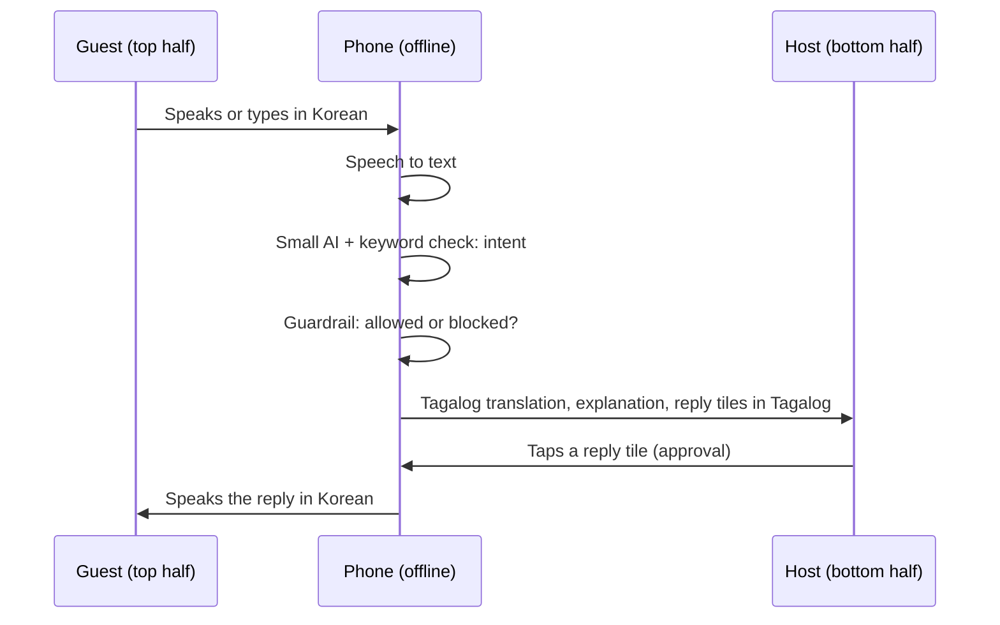

# TurAIsta

**Ang AI katuwang ng mga farm host sa pagtanggap ng turista.**
An offline assistant that helps small farm-tour hosts in the Philippine highlands talk with
visitors in any language.

Built with Flutter for the World Bank **Small AI** hackathon, tourism track (Annex C).

## Downloads

| File | Size | Link |
| --- | --- | --- |
| Android APK (arm64, model included) | 617 MB | [Google Drive folder](https://drive.google.com/drive/folders/1dqoWz28Avth6Wq4xk-DwStVfOBuIMMWe?usp=sharing) |
| Intent model `turaista-intent-v2-q8_0.gguf` | 507 MB | Same folder, or Git LFS in this repo |

Install the APK with `adb install -r app-release.apk`, or open it on the phone and allow
installs from unknown sources.

GitHub Actions also builds the APK (workflow **Release APK**). Push a tag such as `v0.2.0` to
publish it on the [Releases page](https://github.com/JpCurada/turaista-jpmc/releases), or run
the workflow by hand from the Actions tab to get it as a download on that run.

---

## Table of contents

1. [The problem](#the-problem)
2. [What TurAIsta does](#what-turaista-does)
3. [How it works](#how-it-works)
4. [Why hosts can trust it](#why-hosts-can-trust-it)
5. [Demo script](#demo-script)
6. [Getting started](#getting-started)
7. [Setting up the phone](#setting-up-the-phone)
8. [The small AI](#the-small-ai)
9. [Project layout](#project-layout)
10. [Testing and quality checks](#testing-and-quality-checks)
11. [Known limits](#known-limits)
12. [Working with Claude Code](#working-with-claude-code)
13. [Roadmap](#roadmap)

---

## The problem

Small farm-tour hosts get a few visitors a month, mostly through word of mouth. They often:

- speak Tagalog, Cebuano or Ilocano, while guests write in Korean, Japanese, Chinese or English
- have no mobile signal at the farm
- use a budget Android phone with about 3 GB of RAM
- rely on a guide or a relative to translate

Generic chatbots do not fit. They need the internet, and they can invent prices or answer
safety questions they know nothing about.

## What TurAIsta does

The app covers four stages of a host's day, and nothing else.

| Stage | What the host does | What TurAIsta does |
| --- | --- | --- |
| **1. Setup** | Enters farm name, directions, price, group size, activities and safety rules. Says how to be addressed and whether to use "po". | Reads every fact back ("Tama po ba na PHP 350 bawat tao?") and saves only confirmed facts on the phone. |
| **2. Inquiry** | Pastes a guest message from Messenger or SMS. | Detects the language, explains the message in Tagalog, and drafts a reply from verified facts only. The host taps "Aprubahan at kopyahin" and sends it. |
| **3. Edge case** | Gets an allergy, health, child-safety or unknown question. | Never drafts an answer. Shows the host "Not sure: ask a local guide/person" and offers a polite holding reply for the guest. |
| **4. Live chat** | Talks with a guest at the farm, face to face. | Split-screen conversation with offline speech, translation and suggested replies the host speaks with one tap. |

Everything runs on the phone. No signal is needed after the one-time language download.

## How it works

### Face-to-face chat (stage 4)

The phone lies flat between the host and the guest. The top half is rotated to face the
guest and shows only the guest's language. The bottom half faces the host and shows Tagalog.



**One guest turn, step by step:**

1. The guest fills in a short **traveler card** once: language, party size, and any needs
   (food or allergy, health, children, mobility). Nothing is preselected or guessed.
2. The guest taps the mic and speaks. The phone turns speech into text on the device.
3. The **small AI** (a fine-tuned 0.5B model) and a **keyword safety check** classify the
   message together. Either one can block it.
4. If the question is allowed, the app builds a reply from the farm profile only.
5. The host sees, in Tagalog:
   - what the guest said (machine translation, labeled as such)
   - what the guest is asking about
   - reply tiles that say what the phone will tell the guest
6. The host taps a tile. That tap is the approval. The phone speaks the reply in the guest's
   language and shows it on the guest's half.

**When the question is blocked:**

1. A red card shows "Not sure: ask a local guide/person" and the guest's question in Tagalog.
2. The first tile is a polite holding reply ("Thank you for your message. The host will
   confirm this with you personally.").
3. A big button, **"Ako na ang sasagot"**, opens the host's mic so the host can answer in
   their own words.

### Message inquiry (stages 2 and 3)

```text
guest message
   -> language detection (ML Kit, offline)
   -> intent: small AI + keywords
   -> guardrail: blocked intents never get a draft
   -> grounded English draft from the farm profile
   -> translation to the guest's language (ML Kit, offline)
   -> number check: same numbers as the English, or fall back to English
   -> host approves and copies; the host sends it
```

## Why hosts can trust it

These rules are enforced in code and tests, not just in prompts.

| Rule | How it is enforced |
| --- | --- |
| **Facts come only from the farm profile.** Prices, group size, activities and directions are never generated by a model. | Replies are built from `FarmProfile` fields. A rules check rejects hard-coded prices in `lib/`. Tests check every number in a reply. |
| **Safety questions are never answered by the app.** Food, allergies, health, children, accessibility, weather risk and anything not in the profile are blocked. | `dietarySafety` and `other` intents never get a draft. A safety hit from the model or the keywords blocks the whole message. |
| **When in doubt, block.** | The model alone cannot unlock a draft. If the keywords recognize nothing, the message is blocked unless the model flags it as a safety question, which also blocks it. |
| **Translations cannot change numbers.** | Every translated reply must contain exactly the numbers of the English draft. Otherwise the app falls back to English and tells the host. |
| **The host approves everything.** | Nothing is sent by the app. In the chat, nothing is spoken until the host taps a reply. An English fallback needs a second tap ("English lang ito. Sabihin pa rin?"). |
| **The host knows what they approve.** | Reply tiles show their meaning in Tagalog, built from the same facts with fixed templates. A test checks that the Tagalog and English have the same numbers, activities and inclusions. |
| **Preferences are asked, never inferred.** | The host chooses how to be addressed and whether to use "po". The guest fills in their own traveler card. Nothing is guessed from age or gender. |
| **Data stays on the phone.** | The profile is saved as a local file. Android backup is turned off. Real profiles are git-ignored. |

## Demo script

A five-minute demo that covers all four stages.

### Before the demo (on Wi-Fi)

1. Install the app on the phone (see [Getting started](#getting-started)).
2. Copy the model to the phone (see [Setting up the phone](#setting-up-the-phone)).
3. Run onboarding once with the example farm:
   - Address: `Manang Lorna`, with "po"
   - Price: `350` per person, up to `12` people
   - Activities: coffee picking walk (included), roasting workshop (`200`), farm lunch (`250`)
4. On Home, tap **I-download ang mga wika** and download all languages.
5. In Android settings, install the offline speech and voice packs for Korean and Filipino.
6. Turn on **airplane mode**. Everything below runs offline.

### 1. Setup (30 seconds)

Open **Tungkol sa farm**. Show the read-back:

> Tama po ba na PHP 350 bawat tao?

**Point to make:** every fact the app will ever state comes from what the host confirmed here.

### 2. A message from a remote guest (1 minute)

Open **May mensahe ang bisita** and paste:

```text
안녕하세요! 이번 주 금요일에 성인 3명 예약 가능할까요? 1인당 가격도 알려주세요.
```

Show:

- the language is detected as Korean
- the Tagalog translation and the explanation for the host
- a Korean draft with PHP 350
- the **Aprubahan at kopyahin** button

**Point to make:** the host sends the reply, never the app.

### 3. A safety question (30 seconds)

Paste:

```text
my daughter has a peanut alergy, how much is lunch for kids?
```

Show the red "Not sure" card and the holding reply.

**Point to make:** the typo is caught, and the message is blocked even though it also asks a price.

### 4. Face-to-face chat (2 minutes)

1. Tap **Live Interpreter**. The screen says **Ibigay ang phone sa bisita**.
2. The guest picks **Korean**, sets **4** people, and taps **Food or allergy**.
3. Lay the phone flat between you. A care reminder appears on the host's half.
4. The guest taps their mic and says: `입장료 얼마예요?`
5. The host reads the Tagalog tile and taps it. The phone answers in Korean.
6. The host taps their mic and says: `Salamat po, maligayang pagdating.`
7. The guest asks: `점심에 땅콩 들어가요?` The red card shows and no answer is offered.
8. Tap the holding reply, then **Ako na ang sasagot** to answer in your own words.

### Close

Everything ran in airplane mode. The app never sent anything. Every price came from the
host's profile.

### If something fails during the demo

| What you see | What to do |
| --- | --- |
| The mic does not work | Use the keyboard button on that side and type. |
| The chip says **AI: wala** | The model was not found or failed to load. Keyword mode still works. Check that the phone has 600 MB free, then reopen the chat. |
| No Korean voice | The reply is shown as text on the guest's half ("Ipinakita sa bisita"). |
| A tile says **Sa English masasabi** | The Korean model is missing or a number changed. Tap **Oo** to say it in English. |

## Getting started

### Requirements

| Tool | Version | Notes |
| --- | --- | --- |
| Flutter | 3.38 or newer | Required by `llamadart` (native assets). |
| Android phone | Android 7.0 (API 24) or newer, arm64 | About 3 GB of RAM is enough. |
| Android SDK and `adb` | Recent | For installing the APK. |
| Git LFS | 3.x | The intent model is stored with Git LFS. |
| Internet | First build only | `llamadart` downloads prebuilt llama.cpp during the first build. |
| Python and [uv](https://docs.astral.sh/uv/) | Optional | Only for `make models` (NLLB export). |

> **Windows users:** install the Flutter SDK in a folder **without spaces** (for example
> `C:\src\flutter`). Native build hooks fail when the SDK path contains a space, which breaks
> `flutter test`, `dart run` and `make check`.

### Get the code and the model

```bash
git lfs install
git clone <repo-url>
cd turaista
git lfs pull     # downloads models/turaista-intent-v2-q8_0.gguf (about 507 MB)
```

### Commands

```bash
make setup    # create android/ios folders, flutter pub get, enable git hooks
make check    # format check, analyze, rules check, tests (what CI runs)
make demo     # inquiry fixtures in the terminal, no device needed
make run      # run on a connected phone or emulator
```

Build an APK for the phone (the model in `models/` is packed inside it):

```bash
flutter build apk --release --target-platform android-arm64
```

The build needs about 2 GB of free disk space, because the model is copied through several
build folders.

## Setting up the phone

### 1. The intent model

The release APK already contains the model. llama.cpp needs a plain file, so on first use of
the chat the app copies it once into its private storage (about 507 MB, a few seconds). The
chat shows **AI: hinahanda** until it is ready. The phone needs about 1.2 GB free in total.

For development, you can instead push a model file without rebuilding. A pushed file takes
priority over the bundled one:

```bash
adb push models/turaista-intent-v2-q8_0.gguf \
  /sdcard/Android/data/ph.turaista.turaista/files/models/
```

If no model is found or it fails to load, the app still works with keyword classification
only, and the chat shows **AI: wala**.

### 2. Download the translation languages

Open the app on Wi-Fi, go to **I-download ang mga wika**, and tap **I-download lahat**. This
downloads English, Tagalog, Korean, Japanese and Chinese once. Downloads only run on Wi-Fi.

### 3. Install offline speech and voices

These come from Android, not from the app:

- **Speech to text:** Google app, then Settings, Voice, Offline speech recognition. Add
  Korean, Japanese, Chinese, English and Filipino if offered.
- **Text to speech:** Android Settings, Text-to-speech output, Install voice data.

The chat checks each language. If a mic or voice is missing, that side switches to typing or
on-screen text.

## The small AI

| Item | Detail |
| --- | --- |
| Base model | Qwen2.5-0.5B-Instruct, fine-tuned for guest intent |
| Format | GGUF, q8_0, about 507 MB, stored with Git LFS |
| Runtime | [`llamadart`](https://pub.dev/packages/llamadart) (llama.cpp), CPU only |
| Output | JSON forced by a grammar: `{"intent": "PRICE", "slots": {"party_size": "4"}}` |
| Intents | `BOOKING`, `PRICE`, `DIRECTIONS`, `DIETARY_SAFETY`, `OTHER` |
| Slots | `party_size`, `date`, `time`, `place`, `item`, `allergen` |

### Speed settings

- context size 512, 4 CPU threads, greedy decoding (temperature 0)
- a fixed system prompt first, so llama.cpp reuses its cache between messages
- a grammar that stops the model as soon as the JSON is complete
- the model loads when the chat opens; until then the chip says **AI: hinahanda**
- if a reply takes more than 3 seconds, the keywords decide for that message

### How the model and the keywords work together

| Keywords found | Model says | Result |
| --- | --- | --- |
| A safety word | anything | **Blocked** |
| An allowed topic (price) | an allowed topic | Answered: both topics |
| An allowed topic | `DIETARY_SAFETY` | **Blocked** |
| Nothing | an allowed topic | **Blocked** (the model alone cannot unlock a draft) |
| Nothing | `DIETARY_SAFETY` | **Blocked** |
| anything | slow, broken or missing | Keywords decide |

Slots the model returns are kept only if they are copied word for word from the guest's
message. The host sees them as quotes, for example
`Nabanggit ng bisita: petsa "Saturday"`. They are never spoken or stated as facts.

### Model metrics (v1, from training)

| Test set | Messages | Accuracy | Notes |
| --- | --- | --- | --- |
| Template test | 159 | 98.1% | `DIETARY_SAFETY` recall 96.6%. The one miss ("Bawal po ako sa gatas") is now caught by the keywords. |
| Wild test | 22 | 81.8% | Misses were mostly slang and Taglish price and directions questions, which now go to the host. |

## Project layout

```text
.
├── .claude/                  Claude Code setup: agents, hooks, skills, settings
├── .githooks/                pre-commit (format, rules, analyze) and pre-push (tests)
├── .github/workflows/        CI
├── assets/
│   ├── fixtures/inquiries.jsonl     30 test messages in en, ko, ja, zh
│   └── profiles/example_farm.json   example farm (fictional)
├── lib/
│   ├── core/                 pure Dart, no Flutter, no network
│   │   ├── profile.dart            FarmProfile: the only source of facts
│   │   ├── onboarding.dart         read-back questions and validation
│   │   ├── intents.dart            keyword classifier and safety lists
│   │   ├── intent_model.dart       small AI prompt, grammar, merge rules
│   │   ├── guardrail.dart          blocked intents, fallback texts
│   │   ├── reply.dart              grounded English drafts
│   │   ├── host_meaning.dart       Tagalog meaning of each reply
│   │   ├── host_text.dart          host-facing explanations and notices
│   │   ├── number_check.dart       translation number check
│   │   ├── pipeline.dart           inquiry flow
│   │   ├── conversation.dart       chat turns and traveler card
│   │   └── translator.dart, language_id.dart, speech.dart, profile_store.dart   interfaces
│   ├── services/             platform and ML implementations
│   │   ├── llama_intent_model.dart       GGUF model with llamadart
│   │   ├── mlkit_translator.dart         ML Kit offline translation and downloads
│   │   ├── mlkit_language_identifier.dart
│   │   ├── device_speech.dart            speech to text and text to speech
│   │   └── file_profile_store.dart       profile saved as JSON on the phone
│   ├── features/             screens, one folder per stage
│   │   ├── setup/            onboarding, language download
│   │   ├── inquiry/          message inquiry
│   │   ├── interpreter/      traveler card and face-to-face chat
│   │   └── home/
│   ├── app.dart
│   └── main.dart
├── model_tools/              Python tools (NLLB to ONNX export)
├── models/                   model files, git-ignored
├── test/                     unit and widget tests
└── tool/demo.dart            terminal demo
```

**Rule of the codebase:** `lib/core` holds every business rule and stays pure Dart, so it is
fully testable without a device. Platform and ML code lives in `lib/services` behind core
interfaces. Screens in `lib/features` only display what core returns.

## Testing and quality checks

```bash
make check
```

This runs, in order:

1. `flutter analyze` with a strict analyzer
2. the project rules check: no hard-coded prices in `lib/`, no Flutter or network imports in
   `lib/core`
3. `flutter test`: 227 tests
4. a format check at page width 100

What the tests cover:

| Area | Examples |
| --- | --- |
| Guardrail | Blocked intents are exactly `DIETARY_SAFETY` and `OTHER`; mixed messages are blocked |
| Classifier | Safety words in five languages, typos, false matches ("coffee" is not a fee), questions without a question mark |
| Small AI merge | The model cannot unlock a draft alone; slow or broken output falls back to keywords |
| Grounding | Every number in a reply comes from the profile; the Tagalog meaning matches the English |
| Translation | Changed numbers fall back to English; a failed translator never leaves the guest without a reply |
| Onboarding | Every fact must be confirmed; an edited fact must be confirmed again |
| Chat UI | One tap speaks; nothing is spoken while listening; used tiles cannot repeat; layout fits a 360x640 phone with the keyboard open |
| Fixtures | 30 realistic guest messages, each marked `draft` or `blocked` |

## Known limits

Read these before relying on the app with real guests.

| Limit | Impact | Current handling |
| --- | --- | --- |
| **Host's own words are spoken without a preview.** | When the host speaks or types freely, the translation is spoken at once. A translation that keeps the numbers but changes the meaning (for example "up to" becoming "at least") is not caught. | Numbers are checked. The bubble shows what the guest heard. Prefer reply tiles for prices and rules. |
| **Machine translation of replies** | Reply tiles are translated by ML Kit. Wording can drift even when numbers match. | Every translated tile is labeled **Isasalin ng app**. The host sees the meaning in Tagalog. |
| **Keyword lists cannot be complete** | Unusual phrasing of a safety question may be missed by the keywords. | The small AI also checks, and unknown messages are blocked by default. |
| **More blocking than needed** | Messages that mention a child, a parent or an age go to the host, even for ordinary bookings. | This is deliberate: when in doubt, block. |
| **Cebuano and Ilocano** | Host screens are in Tagalog only. ML Kit cannot translate Cebuano or Ilocano. | Planned: native-speaker templates and NLLB-200. |
| **Offline speech depends on the phone** | Tagalog speech recognition and the Filipino voice may not be available offline. | The chat switches that side to typing or on-screen text. |
| **Not yet measured on a budget phone** | Speed is estimated at 1.5 to 2.5 seconds per guest turn. | Measure on the target phone before a live demo. |
| **Guest-language card text** | The Korean, Japanese and Chinese traveler card text has not been checked by native speakers. | Review before real use. |

## Working with Claude Code

Open the folder with `claude`. It loads `CLAUDE.md`, the skills, the agents and the hooks.

### Agents

| Agent | Use it for |
| --- | --- |
| `on-device-ml-engineer` | Choosing ML, speech and translation packages; speed and memory on the phone |
| `flutter-ui-engineer` | Building and testing screens |
| `guardrail-auditor` | Read-only review after any change to `lib/core` or to screens that show guest replies |
| `filipino-localization-reviewer` | Read-only review of any host-facing text |
| `demo-scenario-tester` | Checking that the demo journey still works |

Ask by name, for example: *"use the guardrail-auditor on my changes"*.

### Skills

`grounded-replies`, `intent-taxonomy`, `offline-translation`, `host-onboarding`,
`flutter-architecture`. They load automatically when relevant.

### Hooks

- Edits to secrets, model files, lockfiles and real host profiles are blocked.
- Every edited Dart file is formatted and analyzed.
- Hard-coded prices and impure core code are rejected.
- `flutter test` runs before Claude finishes.

Hooks need `dart` and `git` on your PATH. Run `/hooks` inside Claude Code to see them.

## Roadmap

- [x] Offline onboarding with read-back verification and on-device storage
- [x] ML Kit offline translation with one-time Wi-Fi download
- [x] Language auto-detection
- [x] Fine-tuned small intent model on the phone, with keyword safety backup
- [x] Face-to-face chat with offline speech, split screen and one-tap replies
- [ ] Measure speed and memory on a budget Android phone
- [ ] Native-speaker review of guest-language and Tagalog text
- [ ] Cebuano and Ilocano host text, written with native speakers
- [ ] NLLB-200 for Cebuano and Ilocano translation (`make models`)
- [ ] Optional preview before speaking the host's own words
- [ ] A show-to-guest card for prices and directions

## Datasets

From the hackathon brief: MASSIVE (intent), FLORES-200 and NLLB-200 (translation),
Wikivoyage (realistic tourist questions), OpenStreetMap via Overpass, and UN Tourism, WDI and
Enterprise Surveys (problem framing).
