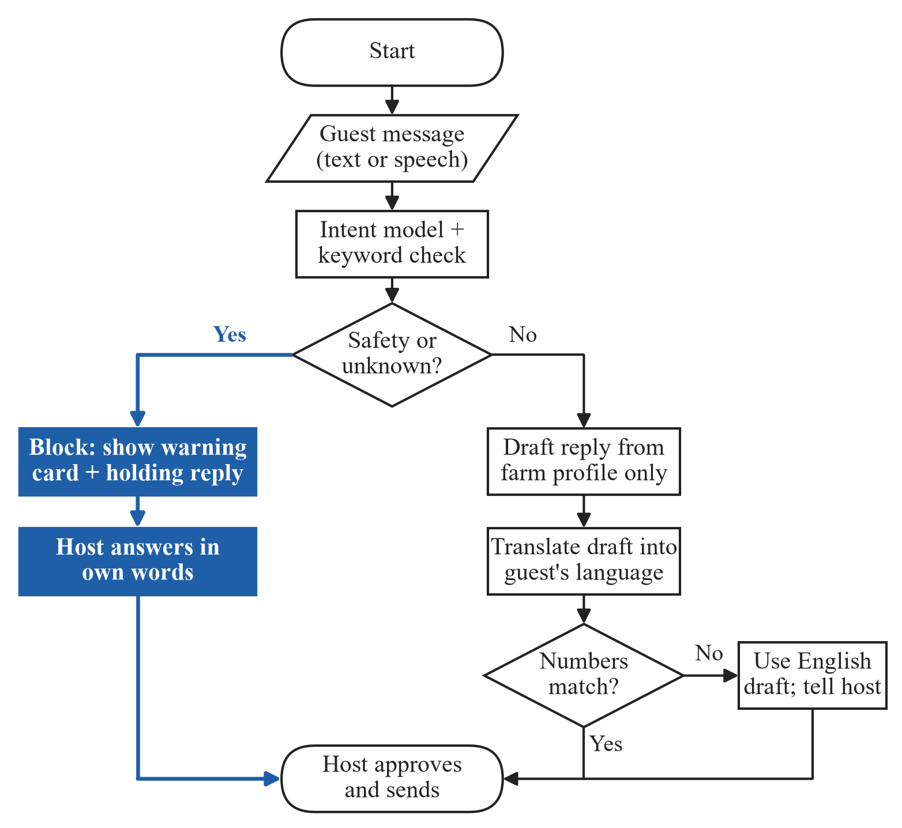
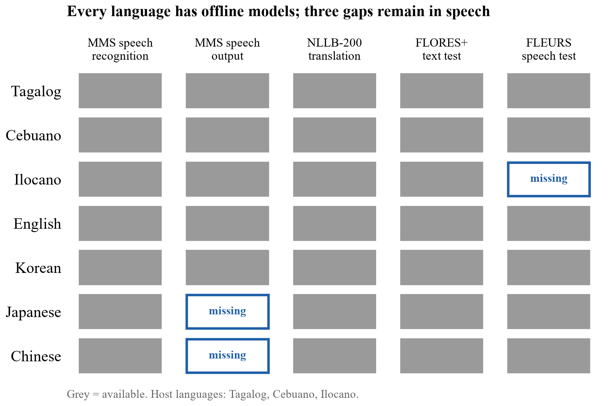
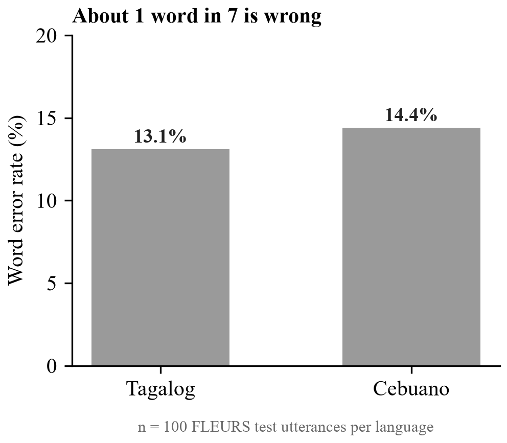
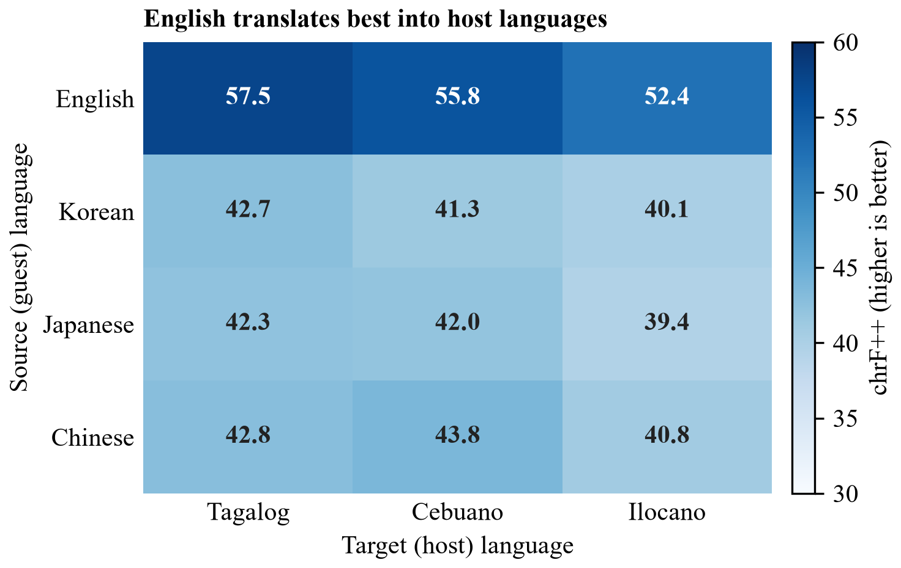
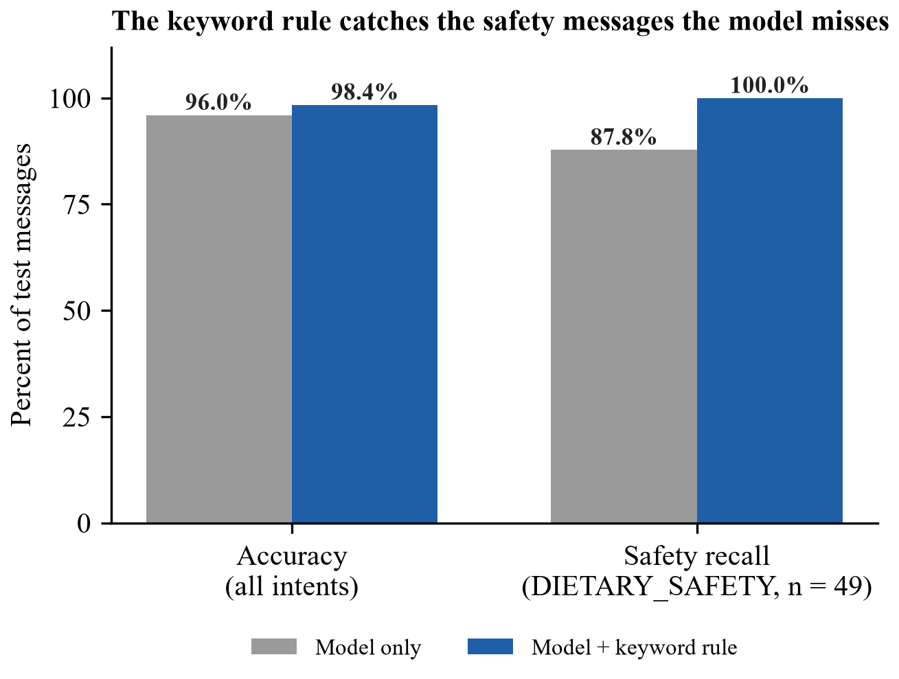

# TurAIsta: A Rule-Guarded Small AI Assistant for Offline Guest Communication by Philippine Farm-Tour Hosts

Polytechnic University of the Philippines

John Paul M. Curada and Marie Criz P. Zaragoza*

johnpaulmcurada@iskolarngbayan.pup.edu.ph, mariecrizpzaragoza@iskolarngbayan.pup.edu.ph

*Corresponding author: Marie Criz P. Zaragoza

## Abstract

Small farm-tour hosts in the Philippine highlands receive guest messages in Korean, Japanese, Chinese and English, often where there is no mobile signal. We examine whether offline small AI can help these hosts communicate with guests safely. We built TurAIsta, an offline Android assistant that explains each guest message in the host's language and drafts a reply using only facts the host has confirmed. The app never answers questions about food, allergies, health, children, accessibility or weather. The host sees a warning and a polite holding reply instead, and the host approves and sends every message. We tested open models that run offline. MMS speech recognition reached a word error rate of 13.1% for Tagalog and 14.4% for Cebuano on 100 FLEURS test utterances each. NLLB-200 (600M) scored chrF++ 52.4 to 57.5 from English into Tagalog, Cebuano and Ilocano, but 39.4 to 43.8 from Korean, Japanese and Chinese, on 100 FLORES+ sentences per direction. On farm-tour sentences, the same model turned "allergic to peanuts" into seeds, apples and vegetables. A Qwen2.5-0.5B model fine-tuned with LoRA classified guest intents with 96.0% accuracy on 250 messages from unseen templates. Adding a keyword safety rule raised accuracy to 98.4% and safety recall from 87.8% to 100%. Offline small AI can support guest communication, but general translation fails on safety-critical words. Safety must therefore be enforced by fixed rules outside the model and by the host.

**Keywords:** small AI; offline translation; agritourism; low-resource languages; Tagalog; Cebuano; Ilocano; guardrails; human-in-the-loop; Philippines

## Introduction

Small farm-tour hosts in the Philippine highlands welcome a few visitors a month, mostly through word of mouth. Many hosts speak Tagalog, Cebuano or Ilocano, while their guests write in Korean, Japanese, Chinese or English. Hosts often rely on a relative or a guide to translate, and many farms have no mobile signal. A Department of Tourism regional director said in 2018 that Filipinos miss tourism opportunities because they lack the skill to speak foreign languages, especially Chinese (Ignacio, 2018).

General chatbots do not fit this setting. They need the internet, and they can state prices or answer safety questions without any verified source. A wrong answer about an allergy can harm a guest. The World Bank promotes "small AI": practical, affordable solutions that run on everyday devices where infrastructure and skills are limited (World Bank, 2026). TurAIsta applies this idea to tourism hosts.

**Terms.** A *guest message* is any text or speech a visitor sends to the host. A *draft* is a reply the app proposes, built only from facts in the host's farm profile. A *block* means the app writes no draft for a message. A *safety message* is any message about food, allergies, health, children, accessibility or weather risk, and it is always blocked. *Host approval* is the host's tap that copies or speaks a draft; nothing leaves the phone without it. A *keyword rule* is a fixed list of safety words that forces a block whatever the model predicts.

**Research question.** Can offline small AI support safe guest communication for Philippine farm-tour hosts? We ask three sub-questions:

1. Which offline speech and translation models cover the host and guest languages, and how well do they perform on public benchmarks?
2. Does offline machine translation keep safety-critical words, such as allergens, intact in farm-tour sentences?
3. Can a small on-device model, combined with a keyword rule, sort guest messages by intent and catch every safety message?

This is a feasibility and validation study. First, it benchmarks open offline models for speech recognition and translation in seven languages. Second, it examines how general translation handles farm-tour safety questions. Third, it fine-tunes a 0.5-billion-parameter intent model and measures what a fixed keyword rule adds to it. Fourth, it turns the results into a design in which the model labels messages, fixed rules block safety questions, and the host decides.

## Related Work

**Language barriers in tourism.** Machine translation can help hospitality businesses bridge language barriers and reduce costs, but most experts interviewed by Carvalho (2024) felt it does not replace staff language skills. In the Philippines, the lack of foreign-language skills has been named as a barrier to tourism growth (Ignacio, 2018). We found no study of language support for Philippine farm-tour hosts.

**Translation errors in high-stakes messages.** Google Translate rendered emergency-department discharge instructions with about 92% accuracy for Spanish and 81% for Chinese, and some errors could cause significant harm (Khoong et al., 2019). In a study with physicians, backtranslation helped them detect clinically harmful errors that quality estimation alone often missed (Mehandru et al., 2023). Numerical mistranslation is a general issue: major commercial systems and research models fail on many numerical test examples, for high- and low-resource languages (Wang et al., 2021).

**Low-resource Philippine languages.** NLLB-200 translates 200 languages, including Tagalog, Cebuano and Ilocano (NLLB Team et al., 2022). MMS covers speech recognition and speech output for 1,107 languages (Pratap et al., 2023). FLEURS provides read-speech test sets for many of these languages (Conneau et al., 2022). FilBench evaluated 27 large language models on Filipino, Tagalog and Cebuano; the best model, GPT-4o, scored about 72% (Miranda et al., 2025). MASSIVE provides labelled virtual-assistant requests in 51 languages (FitzGerald et al., 2022).

**Small AI with a human in the loop.** Pezego-HITL grounds a large language model in agricultural policy for extension services in Ghana and surveyed extension officers and smallholder farmers (Li et al., 2026). In AI-assisted replies, message-level suggestions made people faster and more satisfied, while sentence-level suggestions preserved more sense of agency (Fu et al., 2023). LoRA makes it practical to adapt small language models with few trainable parameters (Hu et al., 2021).

**Gap.** Within our search, we found no study that evaluates offline speech and translation models for Philippine host languages in a tourism setting, and none that measures how a fixed safety rule changes what a small on-device intent model lets through. This is a statement about our search, not about the whole literature.

## Data

TurAIsta's evaluation uses public benchmarks for speech and translation, and farm-tour messages generated from templates for the intent model. Benchmark test sets were used for evaluation only. All experiments ran on a single NVIDIA T4 GPU on Kaggle.

*Table 1. Data sources.*

| Source | Unit | Size | Measures | Known bias |
| --- | --- | --- | --- | --- |
| FLEURS test (Conneau et al., 2022) | Read-speech utterance | 100 per language (Tagalog, Cebuano) | Word error rate | Read speech, not farm conversation; no Ilocano |
| FLORES+ devtest (NLLB Team et al., 2022) | Sentence | 100 per direction, 15 directions | chrF++ | General-domain text, not guest messages |
| Farm-phrase check | English sentence | 5 sentences into 3 host languages | Output inspected for key words | Small; no reference translations |
| Template-generated farm-tour messages | Message | 306 templates; 1,310 training and 250 test sentences | Intent and slots | Written by the team; Tagalog, Korean, Japanese and Chinese not reviewed by native speakers |
| MASSIVE 1.1 (FitzGerald et al., 2022) | Assistant request | 300 sentences, 60 per language | Extra OTHER examples for training | Virtual-assistant domain |
| Hand-written test messages | Message | 22 (4 or 5 per language) | Intent | Hand-written by the team; reused across model versions |

We also audited which languages each model and test set supports, by loading the released checkpoints and dataset configurations directly.

## Method

### The TurAIsta app

TurAIsta is a Flutter app for Android phones with about 3 GB of RAM. After a one-time language download on Wi-Fi, it runs fully offline. Figure 1 shows how one guest message is handled.

**Figure 1.** Flowchart of how TurAIsta handles one guest message. A safety or unknown message is blocked before translation and goes to the host (highlighted path); any other message gets a draft built from the farm profile, which the host must approve.

Facts such as prices, group size, activities and directions come only from the farm profile, never from a model. A translated draft must contain exactly the numbers in the English draft; otherwise the app falls back to English and tells the host. The intent model runs on the phone's CPU through llama.cpp with a 512-token context, 4 threads and greedy decoding, and a grammar forces valid JSON output. If the model is missing or takes longer than 3 seconds, the keyword rule decides alone.

### Templates and split

No public dataset covers farm-tour guest intents, so training and test messages were generated from 306 message templates in English, Tagalog, Korean, Japanese and Chinese. These messages are a test instrument for this study, not a released dataset. There are five intents: BOOKING, PRICE, DIRECTIONS, DIETARY_SAFETY and OTHER. DIETARY_SAFETY covers food, allergies, health, children, accessibility and weather risk. Each language has 10 formal templates per intent, plus casual chat-style templates for BOOKING, PRICE, DIRECTIONS and OTHER (four each in English and Tagalog, two each in Korean, Japanese and Chinese). Slots for party size, date, time, place, item and allergen are filled from lists of farm-tour values.

We split by template, not by sentence. For each language and intent, 20% of the templates go to the test set (random seed 13), so every test sentence comes from a template the model never saw. In training, about half of the sentences also get a chat-style variant: lowercase, no final punctuation and common abbreviations such as "pls" and "hm po". We added 300 OTHER sentences from MASSIVE, 60 per language, drawn only from eight harmless labels such as greetings and date questions, and only when they contained no price, booking, route or safety word. The final training set has 1,610 sentences. The test set has 250 sentences: BOOKING 109, DIETARY_SAFETY 49, PRICE 40, DIRECTIONS 40 and OTHER 12.

### LoRA fine-tuning

The base model is Qwen2.5-0.5B-Instruct (Yang et al., 2024). We applied LoRA (Hu et al., 2021) with rank 16, alpha 32 and dropout 0.05 to all attention and MLP projections, which gives 8.8 million trainable parameters (1.75% of the model). We trained for three epochs with batch size 16 and a peak learning rate of 2 × 10⁻⁴ on a one-cycle schedule. The loss is computed only on the JSON answer. Mean training loss fell from 0.0950 in epoch 1 to 0.0013 in epoch 3. The merged model was converted to GGUF at q8_0 with llama.cpp, giving a 507 MB file that ships inside the app.

### Keyword safety rule

The keyword rule is a fixed list of allergen, diet, health, child, accessibility and weather words in English, Tagalog (including Taglish), Korean, Japanese and Chinese. Any match forces the intent to DIETARY_SAFETY, whatever the model predicts. Short Korean words match only as whole words with particles, and Tagalog words only as whole words, so that "bata" (child) does not match "Batangas".

### Benchmark protocol

Speech recognition used MMS-1B-all (Pratap et al., 2023) with its Tagalog and Cebuano adapters on the first 100 distinct FLEURS test sentences per language. Word error rate was computed after lowercasing and removing punctuation. Translation used NLLB-200 distilled 600M (NLLB Team et al., 2022) with beam size 4 on 100 FLORES+ devtest sentences aligned by sentence id, scored with chrF++ (Popović, 2017). We translated from each guest language into each host language, and from each host language into English. For the farm-phrase check, five farm-tour questions were translated from English into each host language and inspected for their key words.

*Table 2. What each component does.*

| Component | Role | Measured by | Use in the app |
| --- | --- | --- | --- |
| Intent model | Labels intent and copies slots | Accuracy, recall, valid JSON | Suggests the intent |
| Keyword rule | Forces DIETARY_SAFETY on any safety word | Safety recall with and without it | Can block; cannot unlock |
| Guardrail | Blocks DIETARY_SAFETY and OTHER | Unit tests | Decides draft or block |
| Reply templates | Build drafts from the farm profile | Unit tests on every number | Only source of facts |
| Translation + number check | Translates the draft; checks numbers match | chrF++ (benchmark) | Falls back to English on mismatch |
| Host approval | Copies or speaks the reply | Not yet measured | Nothing is sent without it |

### Validity tests

We separate four kinds of validity. *Benchmark validity*: the models perform acceptably on public test sets. *Safety validity*: every safety message is blocked. *Operational validity*: the app runs within the phone's time and memory limits. *Field validity*: hosts and guests can use it and trust it. This study tests benchmark validity (sub-questions 1 and 2) and safety validity on our templates (sub-question 3). Operational and field validity are not yet measured.

## Results

### Offline coverage and benchmark scores (sub-question 1)

Every language has an offline speech recognition model and a translation model, but three gaps remain in speech (Figure 2). FLEURS has no Ilocano test set, and MMS has no Japanese or Chinese speech-output model.

**Figure 2.** Offline model and test-set coverage for the three host and four guest languages. All seven languages have speech recognition and translation; Ilocano lacks a speech test set, and Japanese and Chinese lack MMS speech output.

MMS-1B-all reached a word error rate of 13.1% on Tagalog and 14.4% on Cebuano (Figure 3).

**Figure 3.** Word error rate of MMS-1B-all on 100 FLEURS test utterances per language. About one word in seven is recognized wrongly.

Translation from English into the host languages scored 12 to 15 chrF++ points higher than direct translation from Korean, Japanese or Chinese (Figure 4). Ilocano was the weakest target from every source language. Into English, Tagalog scored 65.6, Cebuano 64.7 and Ilocano 60.1.

**Figure 4.** chrF++ of NLLB-200 (600M) from each guest language into each host language, 100 FLORES+ devtest sentences per direction. English translates best into all three host languages; Ilocano is the weakest target.

### Safety-critical translation errors (sub-question 2)

In the booking, price and directions questions, the key words survived translation: the price question, "four people", "Saturday" and "bus terminal". The allergy question failed in all three host languages, and the trail-safety question failed in Cebuano (Table 3).

*Table 3. NLLB-200 output for two farm-tour safety questions.*

| English source | Host language | NLLB-200 output | Meaning of the error |
| --- | --- | --- | --- |
| My son is allergic to peanuts. | Tagalog | Ang aking anak ay allergic sa mga buto. | allergic to seeds |
| My son is allergic to peanuts. | Cebuano | Ang akong anak nga lalaki alergik sa mga mansanas. | allergic to apples |
| My son is allergic to peanuts. | Ilocano | Ti anakko ket alergiko kadagiti natnateng. | allergic to vegetables |
| Is the trail safe if it rains? | Cebuano | Malipayon ba ang dalan kon mouran? | is the trail happy |

The word for peanut is "mani" in all three host languages. A host reading these outputs could tell a guest that the food is safe when it is not. These errors appeared in a model that scores 52 to 58 chrF++ from English, so a good benchmark score did not protect the one word that mattered.

### Intent model with and without the keyword rule (sub-question 3)

The fine-tuned model alone missed 6 of the 49 safety messages in the template test; with the keyword rule, it missed none (Figure 5). Accuracy rose from 96.0% to 98.4%. Every output was valid JSON, and 75.6% of outputs had exactly the right slots.

**Figure 5.** Intent classification on 250 template-test messages from unseen templates, with and without the keyword rule. The rule raises safety recall from 87.8% to 100% and overall accuracy from 96.0% to 98.4%.

With the keyword rule, template-test accuracy was 100% for English, Korean and Chinese, 97.6% for Japanese and 96.2% for Tagalog. On the 22 wild messages, both the model alone and the model with the rule scored 100%.

The first version of the model scored 98.1% on its template test but only 81.8% on the wild messages. It missed "Bawal po ako sa gatas" ("I can't have milk") because the keyword list had no Tagalog, and it labelled casual price and directions questions as OTHER. The second version added Tagalog and Taglish keywords and casual templates. One error remains in our examples: "Salamat po sa masarap na lunch!" ("Thank you for the delicious lunch!") was labelled PRICE. The error is harmless, because a PRICE draft uses only profile facts and the host reads it before sending.

## Answers

(1) Yes, with gaps. Offline models cover all seven languages for speech recognition and translation. Speech recognition errs on about one word in seven, and translation is clearly stronger from English than from Korean, Japanese or Chinese. Ilocano has no speech test set. (2) No. General translation lost the allergen in all three host languages and turned "safe" into "happy" in Cebuano. (3) Yes, but only with the keyword rule. The model alone missed 12.2% of safety messages; the rule caught all of them.

## App Prototype

The TurAIsta prototype covers four stages of a host's day. In setup, the host enters the farm's name, directions, price, group size, activities and safety rules, chooses how to be addressed and whether to use "po", and the app reads each fact back for confirmation ("Tama po ba na PHP 350 bawat tao?"). In an inquiry, the host pastes a guest message from Messenger or SMS; the app explains it in Tagalog and drafts a reply, which the host copies and sends. For a safety question, the app shows "Not sure: ask a local guide/person" and a polite holding reply. In live chat, the phone lies flat between host and guest, translates speech both ways and speaks a reply only after the host taps it. The farm profile stays on the phone, Android backup is turned off, and preferences are asked, never inferred from age or gender.

## Discussion and Use

**Prior work.** Our safety-critical errors match the emergency-room findings: machine translation can be accurate on average and still harmful on single words (Khoong et al., 2019; Mehandru et al., 2023). The number check in TurAIsta responds to the numerical errors reported by Wang et al. (2021). The weaker scores for Ilocano and for direct translation from Asian languages agree with FilBench's finding that Philippine languages remain hard for current models (Miranda et al., 2025).

**What hosts can do.**

1. Use TurAIsta to understand guest messages and to answer booking, price and directions questions from their own confirmed facts.
2. Treat every warning card as a question they must answer themselves, in their own words or with a local guide.
3. Keep their farm profile current, because every draft is built from it.

**What they must not conclude.** That a translated message is correct because it reads smoothly; that a missing warning means a message is safe; that a draft can be sent without reading it; or that the app can answer questions about food, health or children.

**What would enable field use.** Native-speaker review of the Tagalog, Korean, Japanese and Chinese templates and of the safety-card wording; a new test set of real or independently written guest messages; a measure of how often harmless messages are blocked; speed and memory measurements on a budget Android phone; and a field study with farm hosts and their guests.

## Limitations

1. **Templates not reviewed by native speakers.** English templates were written by a fluent speaker; Tagalog, Korean, Japanese and Chinese templates still need native review.
2. **Wild test set reused.** The 22 wild messages evaluated version 1 and again version 2, after changes made from version 1's errors. Version 2's 100% is therefore a development score.
3. **Safety recall may be optimistic.** The same team wrote the safety templates and the keyword list. The rule may also block harmless questions that mention children or seniors; we did not measure this.
4. **Tested models differ from some shipped components.** The app translates with ML Kit and listens with Android's offline speech service; we benchmarked NLLB-200 and MMS as open offline options. The intent model was evaluated before conversion to the q8_0 GGUF file.
5. **Small samples.** Speech and translation scores use 100 items per language or direction, one run, without confidence intervals. The safety-error finding rests on five sentences.
6. **Speech gaps.** FLEURS has no Ilocano test set, and MMS has no Japanese or Chinese speech-output model.
7. **No field or device study.** We have not measured how hosts and guests use or trust the app, or its speed and memory use on a phone.

## Data and Code Availability

The app, notebooks and figure script are in the project repository (https://github.com/JpCurada/turaista-jpmc). The notebooks `turaista-dataset-audit`, `turaista-model-eval` and `turaista-intent` contain every number reported here, with their outputs saved. The intent model `turaista-intent-v2-q8_0.gguf` (507 MB) is stored with Git LFS and is packed in the release APK. Public inputs are FLEURS, FLORES+ (openlanguagedata/flores_plus), MASSIVE 1.1, MMS-1B-all, MMS-TTS, NLLB-200 distilled 600M and Qwen2.5-0.5B-Instruct. Training used a fixed random seed of 13.

## Conclusion

We asked whether offline small AI can support safe guest communication for Philippine farm-tour hosts. Offline speech recognition and translation work for Tagalog and Cebuano, with weaker results for Ilocano and for translation from Korean, Japanese and Chinese. General translation failed on the words that matter most for safety, and a fine-tuned intent model alone missed 12.2% of safety messages. A fixed keyword rule closed that gap on our test set. Small AI for tourism should keep the model in a narrow role, enforce safety with rules outside the model, and leave the final word to the host. Native-speaker review, an independent test set and a field study with hosts are the next steps.

## References

Carvalho, I. (2024). Machine translation in tourism: Implications for the hospitality industry. *INVTUR Proceedings*. Universidade de Aveiro. https://proa.ua.pt/index.php/invtur/article/view/33757

Conneau, A., Ma, M., Khanuja, S., Zhang, Y., Axelrod, V., Dalmia, S., Riesa, J., Rivera, C., & Bapna, A. (2022). *FLEURS: Few-shot learning evaluation of universal representations of speech* (arXiv:2205.12446). arXiv. https://doi.org/10.48550/arXiv.2205.12446

FitzGerald, J., Hench, C., Peris, C., Mackie, S., Rottmann, K., Sanchez, A., Nash, A., Urbach, L., Kakarala, V., Singh, R., Ranganath, S., Crist, L., Britan, M., Leeuwis, W., Tur, G., & Natarajan, P. (2022). *MASSIVE: A 1M-example multilingual natural language understanding dataset with 51 typologically-diverse languages* (arXiv:2204.08582). arXiv. https://doi.org/10.48550/arXiv.2204.08582

Fu, L., Newman, B., Jakesch, M., & Kreps, S. (2023). Comparing sentence-level suggestions to message-level suggestions in AI-mediated communication. *Proceedings of the 2023 CHI Conference on Human Factors in Computing Systems*. https://doi.org/10.1145/3544548.3581351

Hu, E. J., Shen, Y., Wallis, P., Allen-Zhu, Z., Li, Y., Wang, S., Wang, L., & Chen, W. (2021). *LoRA: Low-rank adaptation of large language models* (arXiv:2106.09685). arXiv. https://doi.org/10.48550/arXiv.2106.09685

Ignacio, R. J. (2018, August 6). Language issue hampering PH tourist market. *The Manila Times*. https://manilatimes.net/2018/08/06/business/language-issue-hampering-ph-tourist-market/427161

Khoong, E. C., Steinbrook, E., Brown, C., & Fernandez, A. (2019). Assessing the use of Google Translate for Spanish and Chinese translations of emergency department discharge instructions. *JAMA Internal Medicine, 179*(4), 580–582. https://doi.org/10.1001/jamainternmed.2018.7653

Li, S., Yuan, Z., Ofori, A., Fosu-Mensah, B. Y., Li, Y., Junjanna, M. K., Xue, Q., & Yang, P. (2026). *Pezego-HITL: A policy-grounded large language model architecture for agricultural extension in Ghana* (arXiv:2607.13934). arXiv. https://doi.org/10.48550/arXiv.2607.13934

Mehandru, N., Agrawal, S., Xiao, Y., Gao, G., Khoong, E., Carpuat, M., & Salehi, N. (2023). Physician detection of clinical harm in machine translation: Quality estimation aids in reliance and backtranslation identifies critical errors. In *Proceedings of the 2023 Conference on Empirical Methods in Natural Language Processing* (pp. 11633–11647). Association for Computational Linguistics. https://doi.org/10.18653/v1/2023.emnlp-main.712

Miranda, L. J. V., Aco, E., Manuel, C., Cruz, J. C. B., & Imperial, J. M. (2025). *FilBench: Can LLMs understand and generate Filipino?* (arXiv:2508.03523). arXiv. https://doi.org/10.48550/arXiv.2508.03523

NLLB Team, Costa-jussà, M. R., Cross, J., Çelebi, O., Elbayad, M., et al. (2022). *No language left behind: Scaling human-centered machine translation* (arXiv:2207.04672). arXiv. https://doi.org/10.48550/arXiv.2207.04672

Popović, M. (2017). chrF++: Words helping character n-grams. In *Proceedings of the Second Conference on Machine Translation* (pp. 612–618). Association for Computational Linguistics. https://doi.org/10.18653/v1/W17-4770

Pratap, V., Tjandra, A., Shi, B., Tomasello, P., Babu, A., Kundu, S., et al. (2023). *Scaling speech technology to 1,000+ languages* (arXiv:2305.13516). arXiv. https://doi.org/10.48550/arXiv.2305.13516

Wang, J., Xu, C., Guzmán, F., El-Kishky, A., Rubinstein, B., & Cohn, T. (2021). As easy as 1, 2, 3: Behavioural testing of NMT systems for numerical translation. In *Findings of the Association for Computational Linguistics: ACL-IJCNLP 2021* (pp. 4711–4717). Association for Computational Linguistics. https://doi.org/10.18653/v1/2021.findings-acl.415

World Bank. (2026, April 2). *Small AI, big impact*. https://www.worldbank.org/en/topic/digital/brief/small-ai-big-impact

Yang, A., Yang, B., Zhang, B., et al. (2024). *Qwen2.5 technical report* (arXiv:2412.15115). arXiv. https://doi.org/10.48550/arXiv.2412.15115
